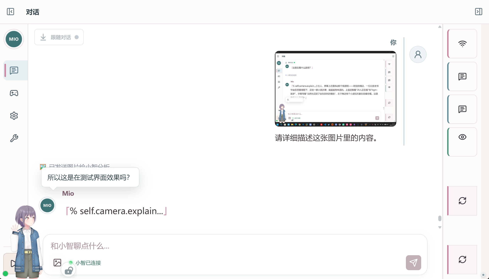
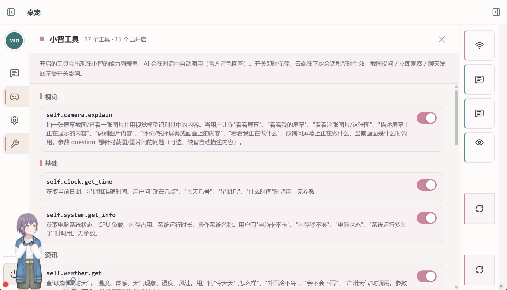

# Mao · 跨 Agent Live2D 桌宠系统

> **一切皆插件 · 跨平台跨 Agent · 实时显示工作状态**
>
> 把开源桌宠 Mio 深度改造为跨 Agent 的"脸"：桌宠本身无状态，只认统一总线上的标准 phase；
> 任何 Agent（小智 / DSH / Octop / 自研）接入一根状态总线即可驱动它——**即换即用，无需重启**。
> 小智为默认语音主通道：官方免费云（test-token），视觉 / 语音 / 对话全部免费。

[](https://github.com/xkk6663/Mao)
[](https://github.com/xkk6663/Mao)
[](https://github.com/xkk6663/Mao)
[](https://github.com/xkk6663/Mao)
[](https://github.com/xkk6663/Mao)
[](https://github.com/xkk6663/Mao)
[](https://github.com/xkk6663/Mao)
[](https://github.com/xkk6663/Mao)

---

## 核心特性

| 关键词 | 能力 |
|---|---|
| 🧩 **一切皆插件** | 15 项本地免费 MCP 工具按需开关（系统 / 网络 / 时间 / 天气 / 备忘…），开启即进小智能力列表，对话中自动调用、官方音色回答 |
| 🔀 **跨平台跨 Agent** | 统一 12-phase 状态总线 + 可插拔适配器；小智 / DSH / Octop 已内置，**新增 Agent 只写一个适配器，前端零改动** |
| 📡 **实时工作状态** | 桌宠头顶徽标实时显示 Agent 工作细分状态（思考 / 执行工具 / 说话 / 聆听…），4 秒自动淡出，右键可开关 |
| 👧 **Live2D 桌宠** | PixiJS + Cubism 渲染；8 个官方免费模型开箱即用，支持导入 / 切换 / 每日自动换装、口型同步 + 表情联动 |
| 🐭 **鼠标跟随** | 桌宠视线跟随鼠标移动；完全自由拖拽，无回弹无限位，位置记忆、重启原样恢复 |
| 💬 **可互动** | 文字 / 图片对话、截图提问、屏幕观察、官方音色语音 + 逐句文本；长连接免唤醒，即发即答 |

### 功能展示

**主聊天界面**（MIO 管理窗口 · 对话页）：与小智的完整往来记录实时显示，文字 / 图片发送、官方音色语音 + 逐句文本。



**小智工具界面**（MIO 管理窗口 · 小智工具页）：本地免费 MCP 工具集中管理，按需开关。



---

## 架构

```
┌──────────────────────────── 本地（你的电脑） ────────────────────────────┐
│  Electron 前端（桌宠=脸）                                                │
│    live2d-pet：PixiJS+Cubism 渲染，只认 phase → 动作/表情/口型/徽标       │
│    对话浮窗 / MIO 管理窗（对话+Agent+设置+小智工具）/ 截图选区 / 穿透+视线  │
│                              ▲ HTTP / WebSocket                          │
│  FastAPI 后端（端口 8000）                                               │
│    agent_bus_service ── 12 phase 统一状态总线：注册/上报/调度/心跳/广播    │
│        ▲ register / emit / heartbeat / set_status / set_enabled          │
│    ┌────┴──────────┬──────────────┬──────────────┐                       │
│    │ xiaozhi       │ dsh          │ octop        │ ← 适配器（可插拔）    │
│    │ 适配器(内置)   │ 适配器+边车   │ 适配器(框架)  │                       │
│    └───────────────┴──────────────┴──────────────┘                       │
└───────────────────────────────────────────────────────────────────────────┘
        │ wss://api.tenclass.net/xiaozhi/v1/（小智默认语音主通道）
        ▼
┌──────────────────────── 小智官方免费云 ────────────────────────┐
│  ASR 识别 → LLM 对话（支持设备侧 MCP 工具）→ TTS 官方音色      │
│  视觉分析（vision/explain MCP）→ 识别文本回灌 → 官方音色语音  │
└────────────────────────────────────────────────────────────────┘
```

**核心设计**（踩坑定型的架构决策）：

1. **桌宠无状态，只认 phase**：适配器是唯一接触 Agent 私有协议的代码；新增 Agent = 新增适配器，渲染端零改动。
2. **活跃聚焦调度**：按 phase 优先级决定"谁占据桌宠身体"（voice 最高、idle 最低）；同 phase 300ms 节流，静默 8s 允许抢占。
3. **音频只在桌宠本体播放**：对话窗只收文本，音频由桌宠播放，从根上避免多窗口声音叠加。
4. **图片识别走官方视觉 MCP 链路**：设备侧实现 MCP server（initialize / tools/list / tools/call），官方视觉 API 识别文本回灌官方 LLM → 官方音色语音，触发语由用户提示词配置（不写死）。
5. **穿透交互架构**：`--no-sandbox` 下渲染层鼠标转发失效 → 主进程 120ms 轮询鼠标 + 渲染层上报模型区域 / UI 状态驱动穿透（仅状态翻转才调 `setIgnoreMouseEvents`，状态去重根治拖动卡顿）。
6. **语音引擎 edge-tts**：SAPI 损坏后切换微软在线 TTS（晓晓音色）+ 触发语预合成缓存（wav+opus 双层 LRU、启动预热 10 条）——触发语注入从 2-3s 降到 **0ms**。
7. **语音完整播放**：tts stop 改 drain 收尾——等已排程音频自然播完再停口型/说话态，不再"没讲完就结束"。

---

## 快速开始

```powershell
# 1. 首次安装依赖（自动检测 Python/Node → venv → Electron，约 5 分钟）
pwsh -NoProfile -ExecutionPolicy Bypass -File 安装依赖.ps1

# 2. 启动桌宠（后端 + Electron 一次拉起，启动窗口自动关闭）
pwsh -NoProfile -ExecutionPolicy Bypass -File start_mio.ps1
```

- **环境要求**：Windows 10/11 x64 · PowerShell 7（pwsh）· Python 3.10+ · Node.js 18+ · 能访问小智官方云
- 首次启动自动生成设备身份 `xiaozhi_device.json`（机器码 = MAC 后 6 位），到[小智控制台](https://xiaozhi.me/console/agents)绑定即可对话
- 开机自启已内置（注册表 `HKCU\...\Run` → `start_mio.ps1`）

**日常使用**：桌宠右键菜单（对话窗 / 调整大小 / 截图提问 / 隐藏气泡 / 隐藏徽标 / 打开 Mio / 关闭）；MIO 管理窗口左侧导航：**对话 / 桌宠 / 设置 / 小智工具 / Agent**，统一内嵌框架。

**导入新模型**：把 Cubism 3/4 模型目录放进 `澪Agent应用\dist\live2d-pet\models\`，桌宠管理页切换形象。

---

## Agent 接入（★ 跨 Agent 核心）

### 12 个标准 phase

| phase | 含义 | 桌宠表现 | 徽标 |
|---|---|---|---|
| `idle` | 待机 | 待机动画 | ✕ |
| `planning` | 规划任务 | 思考动画 | ✓ |
| `thinking` | 思考中 | 思考动画 | ✓ |
| `executing_tool` | 调用工具/执行 | 观察动作 | ✓ |
| `streaming` | 文本流式输出 | 回应动画 | ✓ |
| `waiting_input` | 聆听 | 聆听动作 | ✓ |
| `voice` | 语音播报 | 说话口型 | ✓ |
| `complete` | 单轮完成 | 待机 | ✕ |
| `error` | 出错 | 待机 | ✕ |
| `paused` | 暂停/断线待恢复 | 待机 | ✕ |
| `awaiting_approval` | 等待审批 | 回应动画 | ✓ |
| `heartbeat` | 存活心跳 | 无 | ✕ |

> 徽标口径：连接/断连/在线（offline/connecting/online）与 idle/complete/paused/heartbeat 等**非工作状态不显示**，只有工作中细分状态（planning/thinking/executing_tool/streaming/waiting_input/voice/awaiting_approval）才在桌宠头顶短暂展示 4 秒——避免小智频繁重连导致闪烁。

### 接入一个新 Agent（三步）

1. **建适配器** `backend/app/xx_adapter.py`（照抄 `dsh_adapter.py` 骨架）：读配置 → 解析 Agent 原生事件 → 映射为 phase → `bus.emit`
2. **挂载后台任务**：`backend/app/main.py` 的 `BACKGROUND_TASK_FACTORIES` 加一行
3. **配置 + 忽略**：建 `xx_config.json`（含 token 的配置入 `.gitignore`）

```python
# 最小适配器骨架
async def my_adapter_loop():
    bus.register("myagent", "我的Agent", "my_adapter",
                 capabilities={"voice": False, "text": True, "screen": False, "mcp": False, "observe": False})
    while True:
        # 事件来源任意：WS 订阅 / HTTP 轮询 / 子进程回传……
        phase, state = parse_event(await get_event())   # 映射到标准 phase
        if phase:
            bus.heartbeat("myagent")
            bus.emit("myagent", phase, state=state)
        await asyncio.sleep(1)
```

> 总线对事件来源零假设：任何进程/语言，只要能调总线 API（HTTP/WS）即可驱动桌宠。

### 已内置适配器

| Agent | 适配器 | 能力 | 配置 | 说明 |
|---|---|---|---|---|
| 小智 | `routes/xiaozhi.py` 内嵌 | voice/text/screen/mcp/observe 全开 | 无需配置 | 官方免费云，语音主通道 |
| DSH | `dsh_adapter.py` + `dsh_log_stream.mjs` | text/mcp | `dsh_config.json` | DeepSeek Harness，真实会话日志（zstd 逐帧解）→ phase；无 token 不占端口 |
| Octop | `octop_adapter.py` | text | `octop_config.json` | TencentCloud Octop（FastAPI + LangGraph），WS Hub 订阅 |

> DSH 接入细节（事件→phase 映射 / 摄取通道选型 / 延迟实测 / 排障接口）见 `backend/app/dsh_adapter.py` 注释与自检脚本：`.venv\Scripts\python.exe -m app.dsh_acceptance`、`-m app.dsh_adapter_selftest`。

---

## 目录结构（主干）

```
Mao
├── 澪Agent应用\                     # 前端（Electron + Live2D）
│   ├── live2d-desktop\main.js      # 窗口/托盘/快捷键/截图/穿透轮询/视线跟随
│   ├── dist\live2d-pet\            # 桌宠本体（live2d-pet.js / pet-xz-audio.js / models/）
│   └── dist\                       # MIO 管理窗（agent-switch / settings-panel / mcp-tools / history 注入）
├── 私人AI日记系统\backend\         # 后端（FastAPI，端口 8000）
│   ├── app\agent_bus_service.py    # ★ 跨 Agent 统一状态总线（12 phase/调度/心跳/广播）
│   ├── app\dsh_adapter.py          # ★ DSH 适配器 + 边车 dsh_log_stream.mjs
│   ├── app\octop_adapter.py        # ★ Octop 适配器（框架）
│   ├── app\routes\xiaozhi.py       # ★ 小智核心（WS 代理/say/vision/MCP tools/observe/edge-tts 缓存）
│   └── app\routes\companion.py     # 桌宠状态/设置/位置/agents API
├── start_mio.ps1                   # 一键启动（后端 + Electron）
├── 安装依赖.ps1 / 打包发布.ps1
├── pet-data\Live2D桌宠\            # 桌宠数据目录（runtime.json / 模型 / 日志）
├── xiaozhi_device.json             # 小智设备身份（机器码）
├── xiaozhi_prompts.json            # 图片/观察提示词（可在线编辑）
└── CHANGELOG.md / SRC-MAP-源码地图.md
```

---

## 常见问题

| 问题 | 处理 |
|---|---|
| 对话/图片识别没声音 | 确认「设置 → 语音」流式播放开启；v3.4 起本地引擎为 edge-tts，SAPI 损坏不再影响触发语注入 |
| 语音"没讲完就结束" | v3.5 已修复（tts stop drain 收尾）；重启桌宠确认 `pet-xz-audio.js` 已加载 |
| 跟随不灵敏/拖动卡顿 | v3.5 已修复（穿透状态去重 + getBounds 节流）；重启桌宠确认 `main.js` / `live2d-pet.js` 已加载 |
| 徽标一直闪 | 连接/断连不再显示徽标，仅工作细分状态 4 秒展示；右键可临时隐藏 |
| 经常断连重连 | 官方免费云主动断开空闲连接（1005），后端自动静默重连，三层防阻塞 |
| 小智不调用 MCP 工具 | 到「小智工具」页确认开关已开启（`tools/list` 只返回开启的工具） |
| 切换角色无效 | v3.4 已统一桌宠数据目录（`MIO_PET_STATE_DIR`），确认 `start_mio.ps1` 传入 `pet-data\Live2D桌宠` |
| 桌宠拖拽回弹/限位 | 已完全移除限位，自由拖拽不回弹；重启确认最新 `live2d-pet.js` |

---

## 参考项目与小智资源

| 项目 | 用途 |
|---|---|
| [ochiru520/Mio](https://github.com/ochiru520/Mio) | 本项目上游（Electron + Vue + FastAPI 桌宠） |
| [guansss/pixi-live2d-display](https://github.com/guansss/pixi-live2d-display) | Live2D 渲染库（PixiJS） |
| [78/xiaozhi-esp32](https://github.com/78/xiaozhi-esp32) · [xiaozhi-esp32-server](https://github.com/78/xiaozhi-esp32-server) | 小智官方固件与服务端（协议/视觉/LLM/TTS 管线参照） |
| [xkk6663/Harness_ESP32S31](https://github.com/xkk6663/Harness_ESP32S31) | 端侧人脸识别小智项目（官方音色视觉链路参照） |
| [deepseek-ai/deepseek-harness](https://github.com/deepseek-ai/deepseek-harness) | DSH 单 Agent 运行时（`dsh_adapter.py` 参照） |
| [TencentCloud/Octop](https://github.com/TencentCloud/Octop) | Octop 多用户多 Agent 助手（`octop_adapter.py` 参照） |
| [paperclipai/paperclip](https://github.com/paperclipai/paperclip) | 多 Agent 调度参考（`awaiting_approval` phase 借鉴） |
| [小智控制台](https://xiaozhi.me/console/agents) · [文档](https://xiaozhi.me/docs) · [开发文档](https://xiaozhi.dev) | 设备绑定 / Agent 管理 / 协议与 MCP |

**更新记录**：详细版本历史见 `CHANGELOG.md`。最近：v3.5 性能收尾 + 语音完整播放；v3.4 edge-tts 引擎 + 视线跟随 + 数据目录统一；v3.1 跨 Agent 总线；v3.0 精简发布版。

**开发守则**：改界面先查 `SRC-MAP-源码地图.md`（dist 即源码，改完升 `?v=` 版本参数）；改后端 `python -m py_compile` 校验；改完必 git commit。
