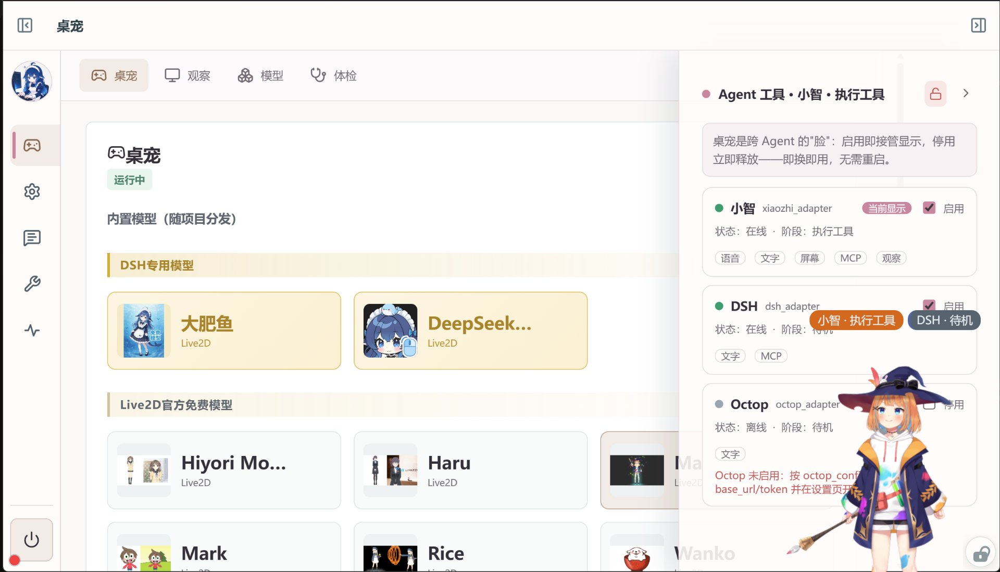
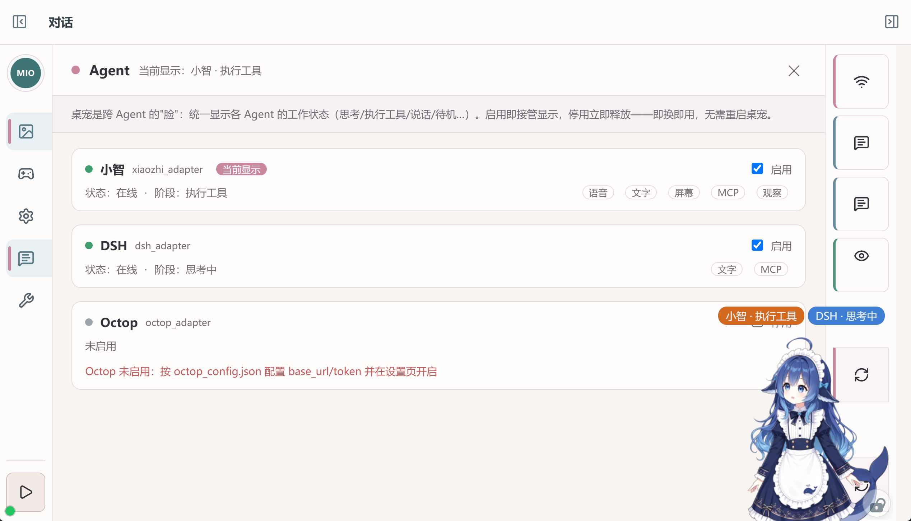
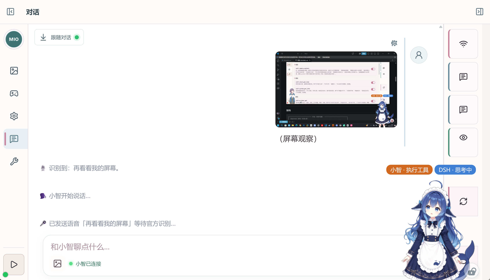
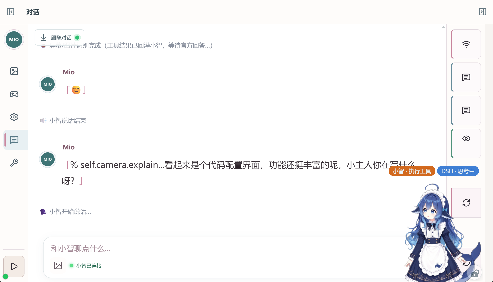
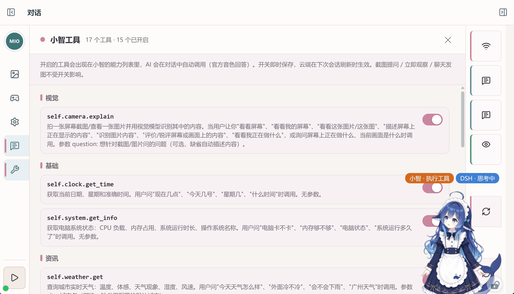

<div align="center">

# 🎀 Mao · 跨 Agent Live2D 桌宠系统

> **一切皆插件 · 跨平台跨 Agent · 实时显示工作状态**
>
> 把开源桌宠 Mio 深度改造为跨 Agent 的"脸"：桌宠本身无状态，只认统一总线上的标准 phase；
> 任何 Agent（小智 / DSH / Octop / 自研）接入一根状态总线即可驱动它——**即换即用，无需重启**。
> 小智为默认语音主通道：官方免费云（test-token），视觉 / 语音 / 对话全部免费。

[](https://github.com/xkk6663/Mao)
[](https://github.com/xkk6663/Mao)
[](https://github.com/xkk6663/Mao)
[](https://github.com/xkk6663/Mao)
[](https://github.com/xkk6663/Mao)
[](https://github.com/xkk6663/Mao)
[](https://github.com/xkk6663/Mao)
[](https://github.com/xkk6663/Mao)

</div>

---

## 核心特性

| 关键词 | 能力 |
|---|---|
| 🧩 **一切皆插件** | 15 项本地免费 MCP 工具按需开关（系统 / 网络 / 时间 / 天气 / 备忘…），开启即进小智能力列表，对话中自动调用、官方音色回答 |
| 🔀 **跨平台跨 Agent** | 统一 12-phase 状态总线 + 可插拔适配器；小智 / DSH / Octop 已内置，**新增 Agent 只写一个适配器，前端零改动** |
| 📡 **实时工作状态** | 桌宠头顶徽标实时显示 Agent 工作细分状态（思考 / 执行工具 / 说话 / 聆听…），4 秒自动淡出，右键可开关 |
| 👧 **Live2D 桌宠** | PixiJS + Cubism 渲染；6 个官方免费 + 2 个项目内置（DeepSeek娘 / 大肥鱼）开箱即用，内置 / 外部导入分区管理，支持切换 / 每日自动换装、口型同步 + 表情联动 |
| 🐭 **鼠标跟随** | 桌宠视线跟随鼠标移动；完全自由拖拽，无回弹无限位，位置记忆、重启原样恢复 |
| 💬 **可互动** | 文字 / 图片对话、截图提问、屏幕观察、官方音色语音 + 逐句文本；长连接免唤醒，即发即答 |
| 🎨 **泡泡工坊** | 8 款气泡皮肤 + 点击桌宠互动（可编排"第 1 次→第 2 次→循环"的点击序列、`a\|b` 等权随机、`{image}` 抽图）+ 图片素材库（可设抽取权重）；全部在 MIO「设置 → 泡泡」页管理，保存即热应用 |
| 🔊 **音效系统** | 7 类事件（按压 / 松开 / 交接 / 任务结束 / 提问 / 授权 / 异常）各自独立开关、音量、自定义片段；片段库支持**浏览器内波形拖选裁剪**（纯前端，无需 ffmpeg），没绑片段则走内置合成音 |
| ⚡ **逐 token 流式** | Agent 正文按上游**原始节奏**逐块铺进桌宠气泡（不是整段一次性弹出），收尾用权威全文校正，零丢字零重复；可一键关闭 |

### 功能展示

#### 🖥️ 主界面区

**主聊天界面**（MIO 管理窗口 · 对话页）：与小智的完整往来记录实时显示，文字 / 图片发送、官方音色语音 + 逐句文本。


**桌宠形象与模型管理**（MIO 管理窗口 · 桌宠页）：内置模型随项目分发，按「DSH 专用模型」（金色标识）与「Live2D 官方免费模型」分区管理，点击卡片即切换形象并**写穿服务端持久化**（重启 / 轮询均不弹回）；右侧 Agent 工具栏实时显示各插件（小智 / DSH / Octop）的在线状态、工作阶段与能力标签，当前显示者高亮标注。



#### 🧩 插件功能展示区

**Agent 管理与状态徽标 · 一切皆插件**（MIO 管理窗口 · Agent 页）：每个 Agent 就是一个可插拔插件，主界面一键启用 / 停用、即插即用，停用立即释放桌宠"身体"；能力标签（语音 / 文字 / 屏幕 / MCP / 观察）一目了然，缺哪个补哪个；实时显示工作细分状态（小智·执行工具 / DSH·完成…），桌宠头顶徽标同步展示、4 秒淡出。



**小智图像分析 · 屏幕观察**：触发"看看我的屏幕"→ 本地截图 → `self.camera.capture` MCP 工具分析 → 识别文本回灌官方 LLM → 官方音色播报；界面右侧可见小智 / DSH 工作状态徽标。



**小智图像分析 · 图片识别**：上传图片 → `self.camera.explain` 视觉工具识别 → 结果回灌小智 → 官方 LLM 分析 + 官方音色回答（"看起来是个代码配置界面…"）。



**小智工具页 · MCP 插件管理**（MIO 管理窗口 · 小智工具页）：本地免费 MCP 工具集中管理（视觉 / 基础 / 资讯分类），17 个工具按需开关，开启即进小智能力列表、对话中自动调用；截图提问 / 观察 / 发图不受开关影响。



#### 🎨 桌宠主体能力（泡泡工坊）

**泡泡工坊 · 点击互动与音效**（MIO 管理窗口 · 设置 → 泡泡）：气泡皮肤（插件身份色优先）、点击序列、图片素材库（含抽取权重）、音效事件（开关/音量/片段）、音效片段库与波形裁剪五块集中管理。

- **点击桌宠**：按「第 1 次 → 第 2 次 → … → 循环」推进自定义序列；未配置时走缺省随机（素材库有图约 45% 出图片）。文本与图片都显示在**复用小智消息的同一个说话气泡框**里，3 秒自动消失。
- **音效**：7 类事件每类可独立开关 / 调音量 / 绑片段；片段库支持上传（≤10MB，`wav/mp3/ogg/opus/m4a/aac/flac/webm`）+ 波形拖选裁剪成新片段；不绑片段就用内置合成音，**零素材依赖开箱可用**。
- **逐 token 流式**：Agent（如 DSH）输出正文时，气泡按上游节奏逐块追加；上游一次性 flush 时会给每块垫一个可感知的最小间隔，播完按文字长度停留 3.5~12 秒。

> 架构上这五块都属于**桌宠主体能力**，不挂在任何插件名下；插件只能经核心 API `window.__mioPetBubble` 说话——所以关掉任意插件，泡泡依然在。

---

## 架构

```
┌──────────────────────────── 本地（你的电脑） ────────────────────────────┐
│  Electron 前端（桌宠=脸）                                                │
│    live2d-pet：PixiJS+Cubism 渲染，只认 phase → 动作/表情/口型/徽标       │
│    对话浮窗 / MIO 管理窗（对话+Agent+设置+小智工具）/ 截图选区 / 穿透+视线  │
│                              ▲ HTTP / WebSocket                          │
│  FastAPI 后端（端口 8000）                                               │
│    agent_bus_service ── 12 phase 统一状态总线：注册/上报/调度/心跳/广播    │
│        ▲ register / emit / heartbeat / set_status / set_enabled          │
│    ┌────┴──────────┬──────────────┬──────────────┐                       │
│    │ xiaozhi       │ dsh          │ octop        │ ← 适配器（可插拔）    │
│    │ 适配器(内置)   │ 适配器+边车   │ 适配器(框架)  │                       │
│    └───────────────┴──────────────┴──────────────┘                       │
└───────────────────────────────────────────────────────────────────────────┘
        │ wss://api.tenclass.net/xiaozhi/v1/（小智默认语音主通道）
        ▼
┌──────────────────────── 小智官方免费云 ────────────────────────┐
│  ASR 识别 → LLM 对话（支持设备侧 MCP 工具）→ TTS 官方音色      │
│  视觉分析（vision/explain MCP）→ 识别文本回灌 → 官方音色语音  │
└────────────────────────────────────────────────────────────────┘
```

**核心设计**（踩坑定型的架构决策）：

1. **桌宠无状态，只认 phase**：适配器是唯一接触 Agent 私有协议的代码；新增 Agent = 新增适配器，渲染端零改动。
2. **活跃聚焦调度**：按 phase 优先级决定"谁占据桌宠身体"（voice 最高、idle 最低）；同 phase 300ms 节流，静默 8s 允许抢占。
3. **音频只在桌宠本体播放**：对话窗只收文本，音频由桌宠播放，从根上避免多窗口声音叠加。
4. **图片识别走官方视觉 MCP 链路**：设备侧实现 MCP server（initialize / tools/list / tools/call），官方视觉 API 识别文本回灌官方 LLM → 官方音色语音，触发语由用户提示词配置（不写死）。
5. **穿透交互架构**：`--no-sandbox` 下渲染层鼠标转发失效 → 主进程 120ms 轮询鼠标 + 渲染层上报模型区域 / UI 状态驱动穿透（仅状态翻转才调 `setIgnoreMouseEvents`，状态去重根治拖动卡顿）。
6. **语音引擎 edge-tts**：SAPI 损坏后切换微软在线 TTS（晓晓音色）+ 触发语预合成缓存（wav+opus 双层 LRU、启动预热 10 条）——触发语注入从 2-3s 降到 **0ms**。
7. **语音完整播放**：tts stop 改 drain 收尾——等已排程音频自然播完再停口型/说话态，不再"没讲完就结束"。
8. **气泡归桌宠主体，插件只经核心 API 说话**：核心暴露 `window.__mioPetBubble`，插件不得直接改 `#speech-bubble` / `#activity-indicator`——否则"关掉某个插件泡泡就没了"会在任何一次插件重构后复发（v4.0 已修掉这个真实回归）。
9. **逐 token 流式是独立的一条 WS 链路**：`agent_stream` 只喂气泡，**不参与 phase 计算、不抢桌宠"身体"**；与状态链路任一失效都不影响另一条。渲染端消费的是同一条消息，**换数据源不需要动前端**。

---

## 快速开始

```powershell
# 1. 首次安装依赖（自动检测 Python/Node → venv → Electron，约 5 分钟）
pwsh -NoProfile -ExecutionPolicy Bypass -File 安装依赖.ps1

# 2. 启动桌宠（后端 + Electron 一次拉起，启动窗口自动关闭）
pwsh -NoProfile -ExecutionPolicy Bypass -File start_mio.ps1
```

- **环境要求**：Windows 10/11 x64 · PowerShell 7（pwsh）· Python 3.10+ · Node.js 18+ · 能访问小智官方云
- 首次启动自动生成设备身份 `xiaozhi_device.json`（机器码 = MAC 后 6 位），到[小智控制台](https://xiaozhi.me/console/agents)绑定即可对话
- 开机自启已内置（注册表 `HKCU\...\Run` → `start_mio.ps1`）

**日常使用**：桌宠右键菜单（对话窗 / 调整大小 / 截图提问 / 隐藏气泡 / 隐藏徽标 / 打开 Mio / 关闭）；MIO 管理窗口左侧导航：**对话 / 桌宠 / 设置 / 小智工具 / Agent**，统一内嵌框架。

**Live2D 模型（内置 / 外部导入分区管理）**：
- **内置模型**：官方 6 个（Hiyori / Haru / Mao / Mark / Rice / Wanko）+ 项目内置 2 个（**DeepSeek娘(鲸鱼娘)** / **大肥鱼**），随仓库分发、克隆即用；默认模型为 DeepSeek娘(鲸鱼娘)。想新增内置模型：把 Cubism 3/4 模型目录放进 `澪Agent应用\dist\live2d-pet\models\<目录名>\`（含 `model3.json` 即自动识别，目录名小写为模型 id），并在 `dist\live2d-pet\live2d-pet.js` 的 `builtInModels` 登记后随 git 入库。
- **外部导入（仅本机）**：桌宠管理页 →「模型」→「导入 Live2D 模型」选择本地模型目录，模型保存到 `pet-data\Live2D桌宠\models\`（不随仓库分发）。

---

## 前端开发与构建（★ 改界面必读）

**`dist/` 不是纯构建产物**——它同时住着两样东西：

| 内容 | 来源 | 是否被构建覆盖 |
|---|---|---|
| `dist/assets/` + `dist/index.html` | **Vue 源码构建**（来自 `澪Agent应用/src/`） | 会被重组 |
| `dist/core-inject/`(7) · `kernel/`(2) · `plugins/`(6) · `live2d-pet/`(242) | **手写原生 JS**（注入层 + 桌宠渲染端） | **绝不能被构建触碰** |

> ⚠ **这就是构建必须隔离输出的原因**：vite 默认 `outDir` 是 `dist` 且构建前会清空它，
> 直接裸跑 `vite build` 会**一次性删掉 257 个手写文件**。
> 本项目已在 `vite.config.js` 设 `build.outDir: 'dist-build'`，请勿移除。

### 改 Vue 界面（`src/` → `dist/`）

```powershell
cd 澪Agent应用
npm ci                 # 严格按 package-lock.json（勿用 npm i，会漂移传递依赖）
npm run build:dist     # 构建 → 组装回 dist → 阉割 → 守卫，一条龙
```

`build:dist` 依次做四件事（也可单独跑）：

| 步骤 | 命令 | 作用 |
|---|---|---|
| 1 | `npm run build` | 只写 `dist-build/`，**不碰 `dist/`** |
| 2 | `npm run compose-dist` | 清空 `dist/assets/` → 拷入产物 → 按模板重生成 `index.html`（保留注入 script 标签与 `?v=`） |
| 3 | `npm run trim-pages` | 5 个页面按既定策略裁成 stub（并重算 `__vite__mapDeps`） |
| 4 | `npm run guard` | 完整性守卫：残留 / 悬空引用 / mapDeps 自洽 |

**验证**：

```powershell
npm test        # 源码单元测试（node --test src/*.test.js）
npm run e2e     # 渲染端 E2E（15 项，需后端在跑）
```

> ⚠ **本环境已知限制**：Node 的 `fs.rmSync` 在 `dist/` 下**会静默失效**（报成功但文件仍在）。
> 若发现 `dist/assets` 里出现两代产物或"无人引用的 assets"，用 `Move-Item` 把旧文件移出后再重跑，
> 并以 `npm run guard` 的 C 项复核（它是唯一能发现残留的检查）。

### 改注入层 / 桌宠渲染端（不经构建）

直接改 `dist/core-inject/`、`dist/plugins/`、`dist/live2d-pet/` 下的文件即可，但：

1. **改了要升 `?v=` 版本参数**（`dist/index.html` 与 `dist/live2d-pet/index.html` 里的引用），否则浏览器缓存不刷新；
2. 渲染端改完必须**实测 DOM 变化**——`render` 执行 ≠ DOM 已更新（详见 `SRC-MAP-源码地图.md` §6）；
3. 改完跑 `npm run guard` 确认没引入悬空引用。

---

---

## Agent 接入（★ 跨 Agent 核心）

### 12 个标准 phase

| phase | 含义 | 桌宠表现 | 徽标 |
|---|---|---|---|
| `idle` | 待机 | 待机动画 | ✕ |
| `planning` | 规划任务 | 思考动画 | ✓ |
| `thinking` | 思考中 | 思考动画 | ✓ |
| `executing_tool` | 调用工具/执行 | 观察动作 | ✓ |
| `streaming` | 文本流式输出 | 回应动画 | ✓ |
| `waiting_input` | 聆听 | 聆听动作 | ✓ |
| `voice` | 语音播报 | 说话口型 | ✓ |
| `complete` | 单轮完成 | 待机 | ✕ |
| `error` | 出错 | 待机 | ✕ |
| `paused` | 暂停/断线待恢复 | 待机 | ✕ |
| `awaiting_approval` | 等待审批 | 回应动画 | ✓ |
| `heartbeat` | 存活心跳 | 无 | ✕ |

> 徽标口径：连接/断连/在线（offline/connecting/online）与 idle/complete/paused/heartbeat 等**非工作状态不显示**，只有工作中细分状态（planning/thinking/executing_tool/streaming/waiting_input/voice/awaiting_approval）才在桌宠头顶短暂展示 4 秒——避免小智频繁重连导致闪烁。

### 接入一个新 Agent（三步）

1. **建适配器** `backend/app/xx_adapter.py`（照抄 `dsh_adapter.py` 骨架）：读配置 → 解析 Agent 原生事件 → 映射为 phase → `bus.emit`
2. **挂载后台任务**：`backend/app/main.py` 的 `BACKGROUND_TASK_FACTORIES` 加一行
3. **配置 + 忽略**：建 `xx_config.json`（含 token 的配置入 `.gitignore`）

```python
# 最小适配器骨架
async def my_adapter_loop():
    bus.register("myagent", "我的Agent", "my_adapter",
                 capabilities={"voice": False, "text": True, "screen": False, "mcp": False, "observe": False})
    while True:
        # 事件来源任意：WS 订阅 / HTTP 轮询 / 子进程回传……
        phase, state = parse_event(await get_event())   # 映射到标准 phase
        if phase:
            bus.heartbeat("myagent")
            bus.emit("myagent", phase, state=state)
        await asyncio.sleep(1)
```

> 总线对事件来源零假设：任何进程/语言，只要能调总线 API（HTTP/WS）即可驱动桌宠。

### 已内置适配器

| Agent | 适配器 | 能力 | 配置 | 说明 |
|---|---|---|---|---|
| 小智 | `routes/xiaozhi.py` 内嵌 | voice/text/screen/mcp/observe 全开 | 无需配置 | 官方免费云，语音主通道 |
| DSH | `dsh_adapter.py` + `dsh_log_stream.mjs` | text/mcp | `dsh_config.json` | DeepSeek Harness，真实会话日志（zstd 逐帧解）→ phase；无 token 不占端口 |
| Octop | `octop_adapter.py` | text | `octop_config.json` | TencentCloud Octop（FastAPI + LangGraph），WS Hub 订阅 |

> DSH 接入细节（事件→phase 映射 / 摄取通道选型 / 延迟实测 / 排障接口）见
> `backend/app/agents/dsh/dsh_adapter.py` 注释与同目录自检脚本
> （`.venv\Scripts\python.exe -m app.agents.dsh.dsh_acceptance`、`-m app.agents.dsh.dsh_adapter_selftest`）。

---

## 目录结构（主干）

```
Mao
├── 澪Agent应用\                     # 前端（Electron + Live2D）
│   ├── src\                        # ★ Vue 源码（20 页 / 108 文件，dist/assets 的构建源）
│   ├── vite.config.js              # ★ 构建配置（outDir=dist-build，隔离输出保护 dist 注入层）
│   ├── scripts\                    # ★ 构建管线（compose-dist / trim-pages / clean-dist / index.template.html）
│   ├── live2d-desktop\main.js      # 窗口/托盘/快捷键/截图/穿透轮询/视线跟随
│   ├── dist\live2d-pet\            # 桌宠本体（live2d-pet.js / pet-sound.js / pet-bubble-styles.js / models/ / libs/）
│   ├── dist\core-inject\           # MIO 管理窗注入（settings-panel / bubble-panel 等）
│   ├── src\*.test.js               # 源码单元测试（node --test）
│   ├── tests\e2e_stream_pet.cjs    # ★ 渲染端 E2E（Playwright，15 项；需后端在跑）
│   └── dist\                       # MIO 管理窗（assets/ + index.html 由构建组装；core-inject/kernel/plugins/live2d-pet 为手写，随仓入库）
├── 私人AI日记系统\backend\         # 后端（FastAPI，端口 8000）
│   ├── app\kernel\agent_bus_service.py   # ★ 跨 Agent 统一状态总线（12 phase/调度/心跳/广播/announce/stream）
│   ├── app\agents\dsh\                   # ★ DSH 插件包（dsh_adapter.py + 边车 dsh_log_stream.mjs + 9 个自检/运维脚本）
│   ├── app\agents\octop\                 # ★ Octop 适配器（框架）
│   ├── app\agents\xiaozhi\               # ★ 小智适配器（WS 代理/say/vision/MCP/observe/chat-history）
│   ├── app\companion\                    # 桌宠主体（配置/音效·图片素材/穿透/位置/事件总线）
│   └── app\routes\companion.py           # 桌宠状态/设置/agents/素材库 HTTP API
├── start_mio.ps1                   # 一键启动（后端 + Electron；幂等，已在跑则跳过）
├── 安装依赖.ps1 / 打包发布.ps1
├── pet-data\Live2D桌宠\            # 桌宠数据目录（runtime.json / 模型 / 日志；pet-data\pet-instance 为实例态）
├── docs\DSH桌宠深度融合技术方案.md  # DSH 融合方案（v3.0：A 档落地 + M1 流式能力边界）
├── xiaozhi_device.json             # 小智设备身份（机器码，不入库）
├── xiaozhi_prompts.json            # 图片/观察提示词（可在线编辑）
└── CHANGELOG.md / SRC-MAP-源码地图.md
```

---

## 常见问题

| 问题 | 处理 |
|---|---|
| 对话/图片识别没声音 | 确认「设置 → 语音」流式播放开启；v3.4 起本地引擎为 edge-tts，SAPI 损坏不再影响触发语注入 |
| 语音"没讲完就结束" | v3.5 已修复（tts stop drain 收尾）；重启桌宠确认 `pet-xz-audio.js` 已加载 |
| 跟随不灵敏/拖动卡顿 | v3.5 已修复（穿透状态去重 + getBounds 节流）；重启桌宠确认 `main.js` / `live2d-pet.js` 已加载 |
| 徽标一直闪 | 连接/断连不再显示徽标，仅工作细分状态 4 秒展示；右键可临时隐藏 |
| 经常断连重连 | 官方免费云主动断开空闲连接（1005），后端自动静默重连，三层防阻塞 |
| 小智不调用 MCP 工具 | 到「小智工具」页确认开关已开启（`tools/list` 只返回开启的工具） |
| 切换角色无效 | v3.4 已统一桌宠数据目录（`MIO_PET_STATE_DIR`），确认 `start_mio.ps1` 传入 `pet-data\Live2D桌宠` |
| 桌宠拖拽回弹/限位 | 已完全移除限位，自由拖拽不回弹；重启确认最新 `live2d-pet.js` |
| 逐 token 流式不生效 | v4.0 新增能力，**需重启后端**（边车以新代码重启 + 设置项 `live2d_stream_text_enabled` 入白名单）；另到「设置 → 泡泡 → 逐 token 流式」确认开关为开 |
| 点击桌宠没反应/气泡不弹 | 「泡泡」页确认「点击桌宠时随机互动」为开；点后 3 秒自动消失属预期（用户裁决不要一直挂着） |
| 音效上传后被拒 | 只收浏览器能解码的格式（`wav/mp3/ogg/opus/m4a/aac/flac/webm`）；WMA/APE/AMR/AIFF/MIDI 请在本地先转 WAV 或 MP3 |

---

## 参考项目与小智资源

| 项目 | 用途 |
|---|---|
| [ochiru520/Mio](https://github.com/ochiru520/Mio) | 本项目上游（Electron + Vue + FastAPI 桌宠） |
| [guansss/pixi-live2d-display](https://github.com/guansss/pixi-live2d-display) | Live2D 渲染库（PixiJS） |
| [78/xiaozhi-esp32](https://github.com/78/xiaozhi-esp32) · [xiaozhi-esp32-server](https://github.com/78/xiaozhi-esp32-server) | 小智官方固件与服务端（协议/视觉/LLM/TTS 管线参照） |
| [xkk6663/Harness_ESP32S31](https://github.com/xkk6663/Harness_ESP32S31) | 端侧人脸识别小智项目（官方音色视觉链路参照） |
| [deepseek-ai/deepseek-harness](https://github.com/deepseek-ai/deepseek-harness) | DSH 单 Agent 运行时（`dsh_adapter.py` 参照） |
| [TencentCloud/Octop](https://github.com/TencentCloud/Octop) | Octop 多用户多 Agent 助手（`octop_adapter.py` 参照） |
| [paperclipai/paperclip](https://github.com/paperclipai/paperclip) | 多 Agent 调度参考（`awaiting_approval` phase 借鉴） |
| [小智控制台](https://xiaozhi.me/console/agents) · [文档](https://xiaozhi.me/docs) · [开发文档](https://xiaozhi.dev) | 设备绑定 / Agent 管理 / 协议与 MCP |

**更新记录**：详细版本历史见 `CHANGELOG.md`。最近：**v4.2.1 形象切换弹回真根因修复（IPC 时序 + 宽限期劫持）**；v4.2 桌宠形象切换持久化 + 体检页接管提速；v4.1 Vue 源码回仓 + 构建管线恢复（fork 起点）；v4.0 A 档收口 + 逐 token 流式；v3.12 泡泡交互重构；v3.11 泡泡工坊迁入管理页。

**开发守则**：改界面先查 `SRC-MAP-源码地图.md`。**Vue 源码已回仓**：改 `澪Agent应用/src/` 后 `npm run build:dist` 重建（守卫 A/B/C/D 全 0 才算过）；手写注入层（`dist/core-inject`、`dist/plugins`、`dist/live2d-pet`）直接改并升 `?v=` 版本参数。改后端 `python -m py_compile` 校验。
